# saasPlug Final UML Model

This is the self-contained final PlantUML deliverable for the saasPlug submission.
All final diagrams are embedded below as PlantUML blocks in the required deliverable order.
The same sources are also kept as individual `.puml` files under `docs/diagrams/final/` for easier editing and validation.

## Assignment Coverage

| Required UML category | Included diagram(s) |
|---|---|
| Use case | 1 |
| Activity | 2, 3, 4 |
| Component | 5 |
| Deployment | 6 |
| Data design / persistence | 7 |
| Class model for exchanged data structures | 8 |
| Class model for service APIs | 9 |
| Sequence | 10, 11, 12, 13, 14, 15 |

## Naming Conventions

- Actors/roles: `EV User` / `EV_USER`, `Provider Admin` / `PROVIDER_ADMIN`, `Operator` / `OPERATOR`, `External Provider APIs`.
- Provider codes: `redPlug`, `greenPlug`, `bluePlug`.
- Services and containers use the implemented Docker/service names from the repository.
- RabbitMQ exchange: `saasplug.events`; main queues: `analytics.events`, `billing.reservations`, `catalog.provider_snapshots`.

## Diagram Index

| Diagram | Source |
|---|---|
| 1. Use Case Diagram | `use-case.puml` |
| 2. Activity Diagram - Search, Status, Reservation | `activity-search-reservation.puml` |
| 3. Activity Diagram - Provider Sync | `activity-provider-sync.puml` |
| 4. Activity Diagram - Invoice And Payment | `activity-invoice-payment.puml` |
| 5. Component Diagram | `component.puml` |
| 6. Deployment Diagram | `deployment.puml` |
| 7. Data Model Diagram | `data-model.puml` |
| 8. Class Diagram - Exchanged Data Structures | `class-data-structures.puml` |
| 9. Class Diagram - Service APIs | `class-service-apis.puml` |
| 10. Sequence Diagram - Login | `sequence-login.puml` |
| 11. Sequence Diagram - Map Search | `sequence-search-map.puml` |
| 12. Sequence Diagram - Status Lookup | `sequence-status-lookup.puml` |
| 13. Sequence Diagram - Reservation | `sequence-reservation.puml` |
| 14. Sequence Diagram - Provider Sync And Catalog Import | `sequence-provider-sync-catalog-import.puml` |
| 15. Sequence Diagram - Analytics And Billing Events | `sequence-analytics-billing-events.puml` |

## 1. Use Case Diagram

Source: `use-case.puml`

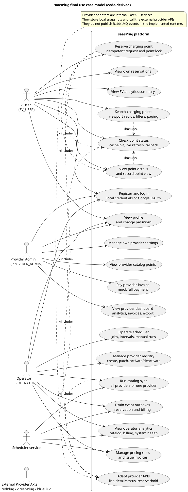

## 2. Activity Diagram - Search, Status, Reservation

Source: `activity-search-reservation.puml`

```plantuml
@startuml
title EV search, status lookup, and reservation activity
skinparam shadowing false

start

partition "EV User / React frontend" {
  :Open /map or point detail;
  :Hold access token from auth-service login;
  :Derive centerLat, centerLng, radiusKm\nfrom map viewport;
  :Apply filters q, providerCode, status,\nconnector, includeStale, limit, offset;
}

partition "nginx-gateway" {
  :Proxy /api/catalog/points to catalog-service;
}

partition "catalog-service" {
  :Validate circle radius\n(max 10 km);
  :Query catalog_points owned by catalog-postgres;
  :Return CatalogPointListResponse\nwith search_circle metadata;
  :Best-effort publish usage.search_performed;
}

partition "React frontend" {
  :Render points on map and list;
  :Request cache-only statuses for visible points;
}

partition "status-service" {
  :POST /cache/statuses reads status_cache only;
  :Return cached statuses and cache metadata;
}

partition "React frontend" {
  if (User selects point?) then (yes)
    :Request catalog detail and record view;
  else (no)
    stop
  endif
}

partition "catalog-service" {
  :Read catalog point detail;
  :Best-effort publish usage.point_viewed;
}

partition "React frontend" {
  :Request live status for selected point\nor force refresh;
}

partition "status-service" {
  if (Fresh cache and no force refresh?) then (yes)
    :Return cached status;
    :Publish status.point_checked\n(cache_hit=true);
  else (no)
    :Acquire per-point in-process lock;
    :Call provider adapter\n/internal/points/{externalPointId}/status;
  endif
}

partition "Provider adapter service" {
  :Call external provider detail/status API;
  :Store raw payload and local normalized snapshot;
}

partition "status-service" {
  if (Provider status succeeds?) then (yes)
    :Upsert status_cache;
    :Append status_check_logs;
    :Publish status.point_checked\n(source=provider_live);
    :Return live status;
  else (no)
    if (Stale cache exists?) then (yes)
      :Record provider error;
      :Return stale cached status with warning;
      :Publish status.point_checked\n(source=cache_fallback);
    else (no)
      :Write failed status_check_logs;
      :Publish status.point_checked error metadata;
      :Return lookup error;
      stop
    endif
  endif
}

partition "React frontend" {
  if (EV reserves point?) then (yes)
    :Send POST /api/reservations/points/{provider}/{id}/reservations\nwith duration and idempotency key;
  else (no)
    stop
  endif
}

partition "reservation-service" {
  :Resolve catalog point through catalog-service;
  :Create/read reservation_idempotency_records;
  :Acquire reservation_point_locks;
  :Reject conflicting active successful reservation;
  :Call provider adapter reservation endpoint;
}

partition "Provider adapter service" {
  :Call external reserve/hold API\nwith provider-specific path/body/query;
  :Return normalized reservation payload;
}

partition "reservation-service" {
  if (Provider confirms future reservation end?) then (yes)
    :Store succeeded reservation and attempt;
    :Estimate energy and reservation cost;
    :Seed status cache as reserved through status-service internal API;
    :Stage reservation.succeeded in reservation_event_outbox;
    :Return ReservationResponse;
  else (ambiguous or failed)
    :Store failed or unknown reservation outcome;
    :Store provider attempt and reconciliation metadata;
    :Stage reservation.failed when applicable;
    :Return error or unknown outcome;
  endif
}

partition "scheduler-service / operator job" {
  :Call reservation-service outbox drain;
  :Publish pending reservation events to RabbitMQ;
}

stop
@enduml
```

## 3. Activity Diagram - Provider Sync

Source: `activity-provider-sync.puml`

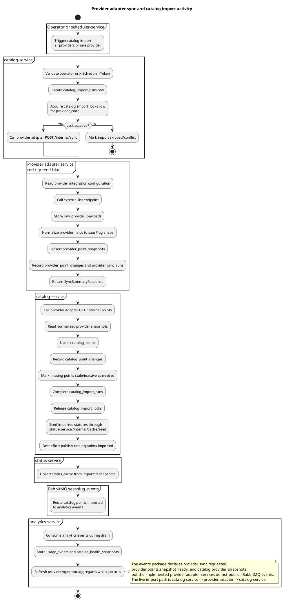

## 4. Activity Diagram - Invoice And Payment

Source: `activity-invoice-payment.puml`

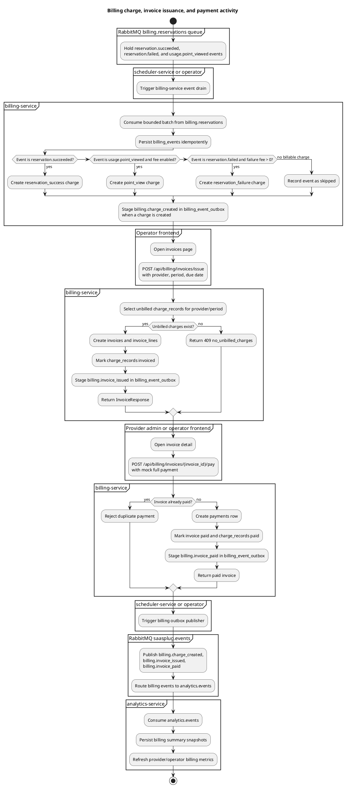

## 5. Component Diagram

Source: `component.puml`

```plantuml
@startuml
title saasPlug final component model (repository and runtime aligned)
left to right direction
skinparam componentStyle rectangle
skinparam shadowing false

actor "EV User" as EV
actor "Provider Admin" as ProviderAdmin
actor "Operator" as Operator

component "Browser\nrole-based React app" as Browser
component "frontend\napps/frontend\nReact/Vite static build\nserved by Nginx on :5173" as Frontend
component "nginx-gateway\ndeploy/nginx/default.conf\npublic HTTP :8080 -> container :80" as Gateway

package "FastAPI services\ninternal Docker port :8000" {
  component "auth-service\nservices/auth-service" as Auth
  component "provider-registry-service\nservices/provider-registry-service" as ProviderRegistry
  component "red-provider-service\nservices/red-provider-service\n/internal only" as RedProvider
  component "green-provider-service\nservices/green-provider-service\n/internal only" as GreenProvider
  component "blue-provider-service\nservices/blue-provider-service\n/internal only" as BlueProvider
  component "catalog-service\nservices/catalog-service" as Catalog
  component "status-service\nservices/status-service" as Status
  component "reservation-service\nservices/reservation-service" as Reservation
  component "analytics-service\nservices/analytics-service" as Analytics
  component "billing-service\nservices/billing-service" as Billing
  component "scheduler-service\nservices/scheduler-service" as Scheduler
}

package "Service-owned PostgreSQL databases" {
  database "auth-postgres" as AuthDb
  database "provider-registry-postgres" as ProviderRegistryDb
  database "red-provider-postgres" as RedDb
  database "green-provider-postgres" as GreenDb
  database "blue-provider-postgres" as BlueDb
  database "catalog-postgres" as CatalogDb
  database "status-postgres" as StatusDb
  database "reservation-postgres" as ReservationDb
  database "analytics-postgres" as AnalyticsDb
  database "billing-postgres" as BillingDb
  database "scheduler-postgres" as SchedulerDb
}

queue "rabbitmq\nsaasplug.events exchange\nanalytics.events queue\nbilling.reservations queue" as Rabbit
component "packages/events\nsaasplug_events" as EventsPackage

cloud "External redPlug API" as RedExternal
cloud "External greenPlug API" as GreenExternal
cloud "External bluePlug API" as BlueExternal

EV --> Browser
ProviderAdmin --> Browser
Operator --> Browser
Browser --> Gateway : HTTP / and /api/*
Gateway --> Frontend : /
Gateway --> Auth : /api/auth/* -> /auth/*
Gateway --> ProviderRegistry : /api/providers/* and /api/provider-registry/*
Gateway --> Catalog : /api/catalog/*
Gateway --> Status : /api/status/*
Gateway --> Reservation : /api/reservations/*
Gateway --> Analytics : /api/analytics/*
Gateway --> Billing : /api/billing/*
Gateway --> Scheduler : /api/scheduler/*

Auth --> AuthDb
ProviderRegistry --> ProviderRegistryDb
RedProvider --> RedDb
GreenProvider --> GreenDb
BlueProvider --> BlueDb
Catalog --> CatalogDb
Status --> StatusDb
Reservation --> ReservationDb
Analytics --> AnalyticsDb
Billing --> BillingDb
Scheduler --> SchedulerDb

Catalog --> RedProvider : import via POST /internal/sync\nGET /internal/points
Catalog --> GreenProvider : import via POST /internal/sync\nGET /internal/points
Catalog --> BlueProvider : import via POST /internal/sync\nGET /internal/points
Catalog --> Status : seed imported status cache\nPOST /internal/cache/seed

Status --> RedProvider : live status\nGET /internal/points/{id}/status
Status --> GreenProvider : live status
Status --> BlueProvider : live status

Reservation --> Catalog : resolve catalog point
Reservation --> RedProvider : reserve\nPOST /internal/points/{id}/reservations
Reservation --> GreenProvider : reserve
Reservation --> BlueProvider : reserve
Reservation --> Status : seed reserved status cache

Scheduler --> Catalog : internal catalog import jobs
Scheduler --> Reservation : reservation outbox publish job
Scheduler --> Billing : billing drain, invoice, outbox jobs
Scheduler --> Analytics : consume events and refresh aggregates

RedProvider --> RedExternal : /points, /point/{id}, /reserve/{id}/{minutes}
GreenProvider --> GreenExternal : /chargingPoints,\n/chargingPoints/{id}/reservations
BlueProvider --> BlueExternal : /locations,\n/location/{id}/status,\n/location/{id}/hold?minutes

Catalog --> Rabbit : publish usage.search_performed,\nusage.point_viewed,\ncatalog.points.imported
Status --> Rabbit : publish status.point_checked
Reservation --> Rabbit : outbox drain publishes\nreservation.succeeded / reservation.failed
Billing --> Rabbit : outbox drain publishes\nbilling.charge_created,\nbilling.invoice_issued,\nbilling.invoice_paid
Rabbit --> Analytics : deliver analytics.events
Rabbit --> Billing : deliver billing.reservations

EventsPackage ..> Catalog : publisher helpers
EventsPackage ..> Status : publisher helpers
EventsPackage ..> Reservation : outbox publisher helpers
EventsPackage ..> Billing : consumer and publisher helpers
EventsPackage ..> Analytics : consumer helpers

note bottom of Gateway
Gateway blocks service-owned internal job prefixes for catalog, reservations,
analytics, and billing. Scheduler calls internal job endpoints over the Docker network.
end note

note right of Rabbit
The events package also declares provider.sync.requested,
provider.points.snapshot_ready, and catalog.provider_snapshots.
Those are topology definitions only in the current code path:
provider adapters do not publish RabbitMQ events.
end note
@enduml
```

## 6. Deployment Diagram

Source: `deployment.puml`

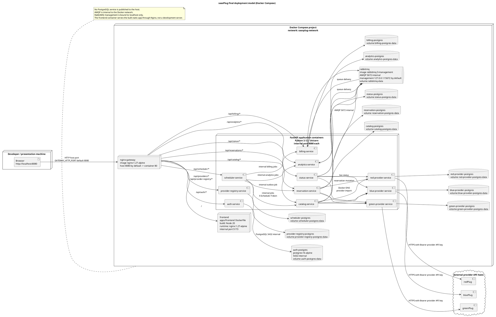

## 7. Data Model Diagram

Source: `data-model.puml`

```plantuml
@startuml
title saasPlug final service-owned data model
left to right direction
hide circle
skinparam linetype ortho
skinparam shadowing false

package "auth-postgres" {
  entity "users" as auth_users {
    * id : uuid
    --
    email
    password_hash
    auth_provider
    google_subject
    last_login_method
    roles
    provider_id
    provider_code
    is_active
    created_at
    updated_at
  }

  entity "refresh_tokens" as refresh_tokens {
    * id : uuid
    --
    user_id
    token_hash
    expires_at
    revoked_at
    created_at
  }

  entity "oauth_states" as oauth_states {
    * id : uuid
    --
    state_hash
    code_verifier
    expires_at
    consumed_at
    created_at
  }

  auth_users ||--o{ refresh_tokens
}

package "provider-registry-postgres" {
  entity "providers" as providers {
    * id : uuid
    --
    provider_code
    display_name
    legal_name
    contact_email
    api_base_url
    api_key_env_var
    api_auth_type
    api_auth_header
    timeout_seconds
    is_active
    is_seeded
    created_at
    updated_at
  }

  entity "provider_config_audit_logs" as provider_audit {
    * id : uuid
    --
    provider_id
    provider_code
    actor_user_id
    actor_email
    actor_roles
    action
    changed_fields
    created_at
  }

  providers ||--o{ provider_audit
}

package "provider-postgres per adapter\nred / green / blue" {
  entity "provider_point_snapshots" as provider_snapshots {
    * id : uuid
    --
    provider_code
    external_point_id
    normalized_point_id
    status
    reservation_ends_at
    price_per_kwh_eur
    capacity
    connector
    location_name
    address
    raw_payload
    payload_hash
    is_active
    last_seen_at
    created_at
    updated_at
  }

  entity "raw_provider_payloads" as raw_payloads {
    * id : uuid
    --
    provider_code
    endpoint
    external_point_id
    payload
    status_code
    fetched_at
  }

  entity "provider_sync_runs" as provider_sync_runs {
    * id : uuid
    --
    provider_code
    status
    started_at
    completed_at
    fetched_count
    upserted_count
    failed_count
    error_message
  }

  entity "provider_point_changes" as provider_changes {
    * id : uuid
    --
    provider_code
    external_point_id
    normalized_point_id
    change_type
    changed_fields
    created_at
  }
}

package "catalog-postgres" {
  entity "catalog_points" as catalog_points {
    * id : uuid
    --
    provider_code
    external_point_id
    normalized_point_id
    display_name
    latitude
    longitude
    status
    reservation_ends_at
    price_per_kwh_eur
    capacity
    connector
    is_active
    is_stale
    last_provider_seen_at
    last_catalog_sync_at
    raw_provider_payload
  }

  entity "catalog_import_runs" as catalog_import_runs {
    * id : uuid
    --
    provider_code
    status
    triggered_by
    provider_sync_triggered
    provider_fetched_count
    catalog_upserted_count
    catalog_changed_count
    catalog_marked_stale_count
    error_message
    started_at
    completed_at
  }

  entity "catalog_import_locks" as catalog_import_locks {
    * provider_code
    --
    owner_run_id
    acquired_at
    expires_at
  }

  entity "catalog_point_changes" as catalog_changes {
    * id : uuid
    --
    provider_code
    external_point_id
    normalized_point_id
    changed_fields
    created_at
  }
}

package "status-postgres" {
  entity "status_cache" as status_cache {
    * id : uuid
    --
    provider_code
    external_point_id
    status
    reservation_ends_at
    price_per_kwh_eur
    capacity
    connector
    fetched_at
    expires_at
    source
    provider_error
  }

  entity "status_cache_policy" as status_policy {
    * id : uuid
    --
    ttl_seconds
    stale_ttl_seconds
    updated_at
  }

  entity "status_check_logs" as status_logs {
    * id : uuid
    --
    provider_code
    external_point_id
    cache_hit
    force_refresh
    provider_called
    returned_stale
    status
    source
    error_message
    checked_at
  }
}

package "reservation-postgres" {
  entity "reservations" as reservations {
    * id : uuid
    --
    user_id
    provider_code
    external_point_id
    status
    duration_minutes
    reservation_starts_at
    reservation_ends_at
    estimated_energy_kwh
    estimated_cost_eur
    reconciliation_required
    created_at
    updated_at
  }

  entity "reservation_attempts" as reservation_attempts {
    * id : uuid
    --
    reservation_id
    provider_code
    external_point_id
    outcome_status
    provider_status_code
    provider_response
    error_message
    created_at
  }

  entity "reservation_idempotency_records" as reservation_idem {
    * id : uuid
    --
    idempotency_key
    user_id
    request_hash
    reservation_id
    status
    response_payload
    created_at
    updated_at
  }

  entity "reservation_point_locks" as reservation_locks {
    * provider_code + external_point_id
    --
    owner_reservation_id
    acquired_at
    expires_at
  }

  entity "reservation_event_outbox" as reservation_outbox {
    * id : uuid
    --
    event_type
    event_payload
    status
    attempts
    next_attempt_at
    published_at
    created_at
  }

  reservations ||--o{ reservation_attempts
  reservations ||--o{ reservation_idem
}

package "analytics-postgres" {
  entity "usage_events" as usage_events {
    * id : uuid
    --
    event_id
    event_type
    provider_code
    external_point_id
    user_id
    occurred_at
    payload
  }

  entity "provider_hourly_metrics" as provider_hourly
  entity "provider_daily_metrics" as provider_daily
  entity "point_daily_metrics" as point_daily
  entity "provider_status_daily_metrics" as status_daily
  entity "operator_daily_metrics" as operator_daily
  entity "ev_reservation_daily_metrics" as ev_daily
  entity "catalog_health_snapshots" as catalog_health
  entity "billing_summary_snapshots" as billing_summary
  entity "export_jobs" as export_jobs
}

package "billing-postgres" {
  entity "pricing_rules" as pricing_rules
  entity "billing_events" as billing_events {
    * id : uuid
    --
    event_id
    event_type
    provider_code
    billable
    processed_status
    payload
    occurred_at
  }

  entity "charge_records" as charge_records {
    * id : uuid
    --
    billing_event_id
    provider_code
    charge_type
    amount_eur
    invoice_id
    paid_at
    created_at
  }

  entity "invoices" as invoices {
    * id : uuid
    --
    provider_code
    invoice_number
    status
    period_start
    period_end
    subtotal_eur
    total_eur
    due_date
    paid_at
  }

  entity "invoice_lines" as invoice_lines {
    * id : uuid
    --
    invoice_id
    charge_record_id
    description
    amount_eur
  }

  entity "payments" as payments
  entity "billing_event_outbox" as billing_outbox {
    * id : uuid
    --
    event_type
    event_payload
    status
    attempts
    next_attempt_at
    published_at
    created_at
  }

  billing_events ||--o{ charge_records
  invoices ||--o{ invoice_lines
  invoices ||--o{ payments
  charge_records ||--o{ invoice_lines
}

package "scheduler-postgres" {
  entity "scheduled_jobs" as scheduled_jobs {
    * id : uuid
    --
    job_key
    target_service
    target_path
    interval_seconds
    cron_expression
    timezone
    enabled
    paused
    updated_at
  }

  entity "job_runs" as job_runs {
    * id : uuid
    --
    job_key
    status
    started_at
    completed_at
    target_http_status
    response_summary
    attempt_count
  }

  scheduled_jobs ||--o{ job_runs
}

providers .. catalog_points : provider_code logical ownership
provider_snapshots .. catalog_points : imported normalized snapshots
catalog_points .. status_cache : provider_code + external_point_id
catalog_points .. reservations : provider_code + external_point_id
reservations .. charge_records : reservation events create charges
charge_records .. billing_summary : billing events feed analytics
usage_events .. provider_daily : aggregate refresh

note bottom
Each package is a separate PostgreSQL container and service ownership boundary.
Cross-package links are logical data flow relationships, not cross-database foreign keys.
end note
@enduml
```

## 8. Class Diagram - Exchanged Data Structures

Source: `class-data-structures.puml`

```plantuml
@startuml
title saasPlug exchanged data structures and event payload classes
left to right direction
skinparam classAttributeIconSize 0
skinparam shadowing false

package "Auth DTOs" {
  enum UserRole {
    EV_USER
    PROVIDER_ADMIN
    OPERATOR
  }
  class RegisterRequest {
    email: EmailStr
    password: string
    roles: UserRole[]
    provider_code: string?
  }
  class LoginRequest {
    email: EmailStr
    password: string
  }
  class AuthTokenResponse {
    access_token: string
    refresh_token: string
    token_type: bearer
    user: UserResponse
  }
  class UserResponse {
    id: UUID
    email: string
    roles: UserRole[]
    provider_code: string?
    is_active: bool
  }
}

package "Provider registry DTOs" {
  class ProviderCreateRequest {
    provider_code: string
    display_name: string
    api_base_url: AnyUrl
    api_key_env_var: string
  }
  class ProviderUpdateRequest {
    display_name: string?
    contact_email: EmailStr?
    api_base_url: AnyUrl?
    is_active: bool?
  }
  class ProviderResponse {
    id: UUID
    provider_code: string
    display_name: string
    is_active: bool
  }
  class ProviderIntegrationConfigResponse {
    provider_code: string
    api_base_url: string
    api_auth_type: string
    timeout_seconds: int
  }
}

package "Provider adapter DTOs" {
  class ProviderIdentityResponse {
    provider_code: string
    display_name: string
  }
  class NormalizedPointResponse {
    provider_code: string
    external_point_id: string
    normalized_point_id: string
    latitude: decimal
    longitude: decimal
    status: string
    reservation_ends_at: datetime?
    price_per_kwh_eur: decimal?
    capacity: decimal?
    connector: string?
  }
  class StatusResponse {
    provider_code: string
    external_point_id: string
    status: string
    reservation_ends_at: datetime?
    source: provider_live
  }
  class ReservationRequest {
    duration_minutes: int
  }
  class NormalizedReservationResponse {
    provider_code: string
    external_point_id: string
    status: string
    reservation_ends_at: datetime?
    raw_payload: object
  }
  class SyncSummaryResponse {
    provider_code: string
    fetched_count: int
    upserted_count: int
    failed_count: int
    status: string
  }
}

package "Catalog and status DTOs" {
  class CatalogSearchCircleResponse {
    center_lat: decimal
    center_lng: decimal
    radius_km: decimal
  }
  class CatalogPointResponse {
    provider_code: string
    external_point_id: string
    display_name: string
    latitude: decimal
    longitude: decimal
    status: string
    price_per_kwh_eur: decimal?
    connector: string?
    is_stale: bool
  }
  class CatalogPointListResponse {
    items: CatalogPointResponse[]
    limit: int
    offset: int
    total: int
    search_circle: CatalogSearchCircleResponse?
  }
  class PointViewRequest {
    view_source: string
    status: string?
  }
  class StatusBatchLookupRequest {
    points: StatusBatchLookupItem[]
    force_refresh: bool
  }
  class StatusLookupResponse {
    provider_code: string
    external_point_id: string
    status: string
    cache_hit: bool
    provider_called: bool
    returned_stale: bool
    source: string
  }
  class StatusCachePolicyResponse {
    ttl_seconds: int
    stale_ttl_seconds: int
  }
}

package "Reservation DTOs" {
  class ReservationCreateRequest {
    duration_minutes: int
    idempotency_key: string?
  }
  class ReservationResponse {
    id: UUID
    user_id: UUID
    provider_code: string
    external_point_id: string
    status: string
    reservation_ends_at: datetime?
    estimated_energy_kwh: decimal?
    estimated_cost_eur: decimal?
    reconciliation_required: bool
  }
  class ReservationAttemptResponse {
    id: UUID
    reservation_id: UUID
    outcome_status: string
    provider_status_code: int?
  }
  class OutboxPublishResponse {
    published_count: int
    failed_count: int
  }
}

package "Billing, analytics, scheduler DTOs" {
  class PricingRuleResponse {
    provider_code: string
    reservation_success_fee_eur: decimal
    point_view_fee_enabled: bool
    reservation_failure_fee_eur: decimal
  }
  class ChargeResponse {
    id: UUID
    provider_code: string
    charge_type: string
    amount_eur: decimal
  }
  class InvoiceResponse {
    id: UUID
    provider_code: string
    invoice_number: string
    status: string
    total_eur: decimal
    lines: InvoiceLineResponse[]
    payments: PaymentResponse[]
  }
  class ProviderSummaryResponse {
    provider_code: string
    total_reservations: int
    revenue_eur: decimal
    status_distribution: object
  }
  class OperatorSummaryResponse {
    providers_count: int
    active_points: int
    revenue_eur: decimal
  }
  class ScheduledJobResponse {
    job_key: string
    target_service: string
    target_path: string
    enabled: bool
    paused: bool
  }
  class JobRunResponse {
    id: UUID
    job_key: string
    status: string
    target_http_status: int?
  }
}

package "Event envelope" {
  class EventEnvelope {
    event_id: UUID
    event_type: EventType
    event_version: string
    occurred_at: datetime
    correlation_id: string
    producer: string
    payload: object
  }
  enum EventType {
    PROVIDER_SYNC_REQUESTED
    PROVIDER_POINTS_SNAPSHOT_READY
    CATALOG_POINTS_IMPORTED
    USAGE_SEARCH_PERFORMED
    USAGE_POINT_VIEWED
    STATUS_POINT_CHECKED
    RESERVATION_SUCCEEDED
    RESERVATION_FAILED
    BILLING_CHARGE_CREATED
    BILLING_INVOICE_ISSUED
    BILLING_INVOICE_PAID
  }
}

AuthTokenResponse --> UserResponse
RegisterRequest --> UserRole
UserResponse --> UserRole
CatalogPointListResponse --> CatalogPointResponse
CatalogPointListResponse --> CatalogSearchCircleResponse
InvoiceResponse --> ChargeResponse
EventEnvelope --> EventType

note bottom of EventType
Exact event routing strings are defined in packages/events/saasplug_events:
provider.sync.requested, provider.points.snapshot_ready, catalog.points.imported,
usage.search_performed, usage.point_viewed, status.point_checked,
reservation.succeeded, reservation.failed, billing.charge_created,
billing.invoice_issued, billing.invoice_paid.
end note
@enduml
```

## 9. Class Diagram - Service APIs

Source: `class-service-apis.puml`

```plantuml
@startuml
title saasPlug service API class model (public and internal APIs)
left to right direction
skinparam classAttributeIconSize 0
skinparam shadowing false

interface "AuthPublicApi" as AuthApi {
  +register()
  +login()
  +refresh()
  +logout()
  +change_password()
  +me()
  +google_login()
  +google_callback()
}

interface "ProviderRegistryApi" as RegistryApi {
  +list_providers()
  +get_provider()
  +create_provider()
  +patch_provider()
  +patch_status()
  +get_integration_config()
  +list_audit_logs()
}

interface "ProviderAdapterInternalApi" as ProviderAdapterApi {
  +identity()
  +list_points()
  +sync()
  +get_point()
  +get_status()
  +reserve()
  +list_sync_runs()
}

interface "CatalogApi" as CatalogApi {
  +list_points()
  +get_point()
  +record_point_view()
  +import_provider()
  +import_all()
  +list_import_runs()
  +freshness()
}

interface "StatusApi" as StatusApi {
  +cache_batch()
  +live_batch()
  +get_point_status()
  +get_cache_entry()
  +get_cache_policy()
  +patch_cache_policy()
  +list_logs()
  +freshness()
}

interface "ReservationApi" as ReservationApi {
  +create_reservation()
  +my_reservations()
  +admin_list_reservations()
  +get_reservation()
  +list_attempts()
  +list_outbox()
  +publish_outbox()
}

interface "AnalyticsApi" as AnalyticsApi {
  +ingest_event()
  +consume_events()
  +refresh_aggregates()
  +provider_summary()
  +provider_trends()
  +provider_top_points()
  +operator_summary()
  +operator_catalog_health()
  +ev_reservation_summary()
  +export_usage_csv()
}

interface "BillingApi" as BillingApi {
  +ingest_event()
  +drain_events()
  +publish_outbox()
  +list_pricing_rules()
  +patch_pricing_rule()
  +effective_pricing()
  +list_charges()
  +issue_invoice()
  +list_invoices()
  +get_invoice()
  +pay_invoice()
  +overview()
}

interface "SchedulerApi" as SchedulerApi {
  +list_jobs()
  +get_job()
  +patch_job()
  +manual_run()
  +pause_job()
  +resume_job()
  +apply_minimum_intervals()
  +reset_default_intervals()
  +run_maintenance()
  +list_runs()
  +health()
}

interface "InternalJobApi" as InternalJobApi {
  +catalog_import_all()
  +catalog_import_provider()
  +reservation_publish_outbox()
  +analytics_consume_events()
  +analytics_refresh_aggregates()
  +billing_drain_events()
  +billing_publish_outbox()
  +billing_prepare_invoices()
}

AuthApi ..> RegistryApi : provider-scoped roles
CatalogApi ..> ProviderAdapterApi : sync and read normalized snapshots
CatalogApi ..> StatusApi : seed cache after imports
StatusApi ..> ProviderAdapterApi : live status lookup
ReservationApi ..> CatalogApi : resolve point
ReservationApi ..> ProviderAdapterApi : reserve point
ReservationApi ..> StatusApi : seed reserved cache
SchedulerApi ..> InternalJobApi : Docker-internal calls
InternalJobApi ..> CatalogApi
InternalJobApi ..> ReservationApi
InternalJobApi ..> BillingApi
InternalJobApi ..> AnalyticsApi

note right of AuthApi
Gateway external paths:
/api/auth/auth/register
/api/auth/auth/login
/api/auth/auth/refresh
/api/auth/auth/logout
/api/auth/auth/password
/api/auth/auth/me
/api/auth/auth/google/login
/api/auth/auth/google/callback
end note

note right of CatalogApi
Public gateway prefix: /api/catalog
Important routes:
GET /points with centerLat, centerLng, radiusKm
GET /points/{provider_code}/{external_point_id}
POST /points/{provider_code}/{external_point_id}/views
POST /imports/all
POST /imports/providers/{provider_code}
Internal scheduler routes under /internal/jobs/catalog/*
end note

note right of StatusApi
Public gateway prefix: /api/status
Cache-only batch: POST /cache/statuses
Live batch: POST /points/statuses
Single live lookup:
GET /points/{provider_code}/{external_point_id}/status
Internal cache seed: POST /internal/cache/seed
end note

note right of ProviderAdapterApi
Provider adapters are not exposed by nginx-gateway.
Internal prefix: /internal
GET /points
POST /sync
GET /points/{external_point_id}
GET /points/{external_point_id}/status
POST /points/{external_point_id}/reservations
end note

note right of ReservationApi
Public gateway prefix: /api/reservations
EV create route:
POST /points/{provider_code}/{external_point_id}/reservations
Outbox publishing is operator-only or scheduler-internal.
end note

note right of BillingApi
Public gateway prefix: /api/billing
Invoices: POST /invoices/issue, GET /invoices,
GET /invoices/{invoice_id}, POST /invoices/{invoice_id}/pay.
Event drain and outbox routes are service-owned jobs.
end note

note right of SchedulerApi
Public gateway prefix: /api/scheduler
Scheduler stores job metadata in scheduler-postgres
and calls internal job endpoints with X-Scheduler-Token.
end note
@enduml
```

## 10. Sequence Diagram - Login

Source: `sequence-login.puml`

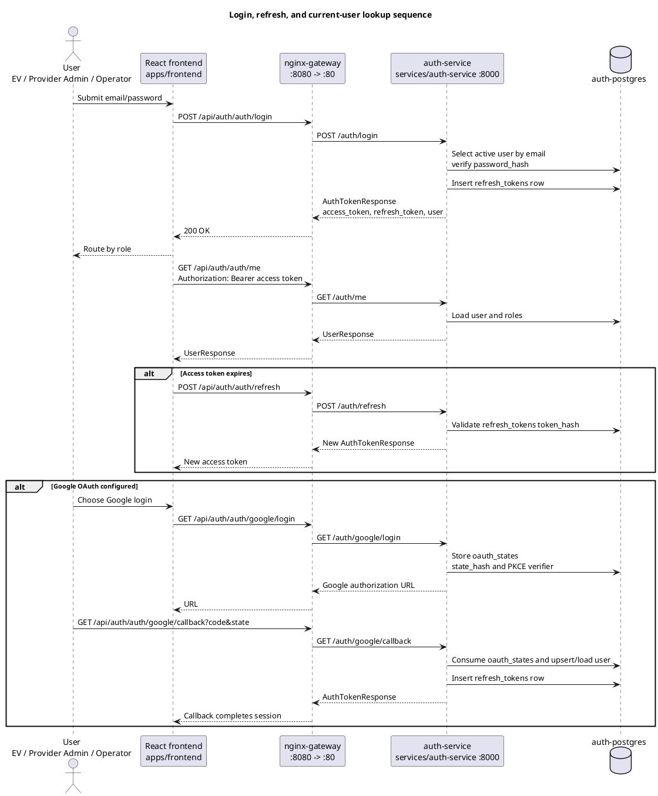

## 11. Sequence Diagram - Map Search

Source: `sequence-search-map.puml`

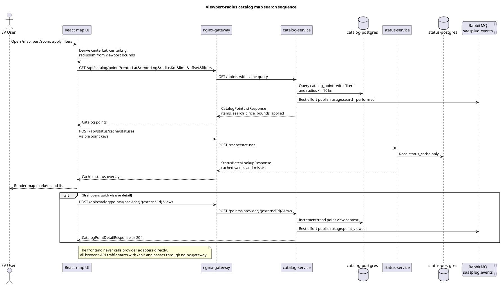

## 12. Sequence Diagram - Status Lookup

Source: `sequence-status-lookup.puml`

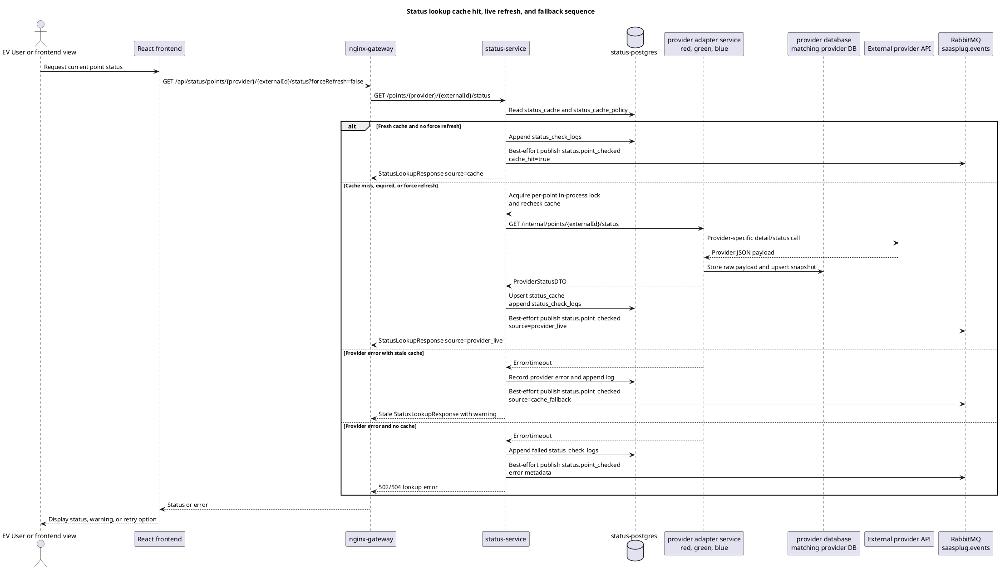

## 13. Sequence Diagram - Reservation

Source: `sequence-reservation.puml`

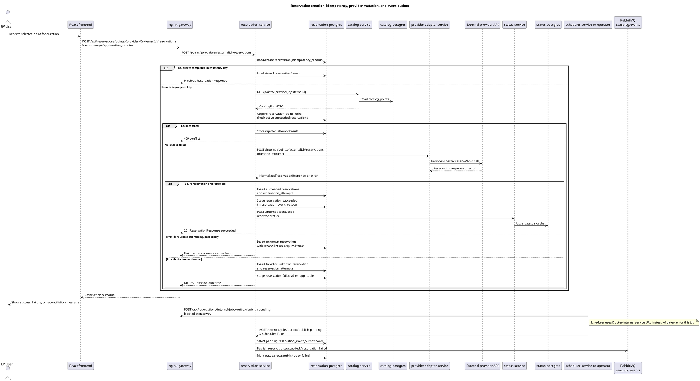

## 14. Sequence Diagram - Provider Sync And Catalog Import

Source: `sequence-provider-sync-catalog-import.puml`

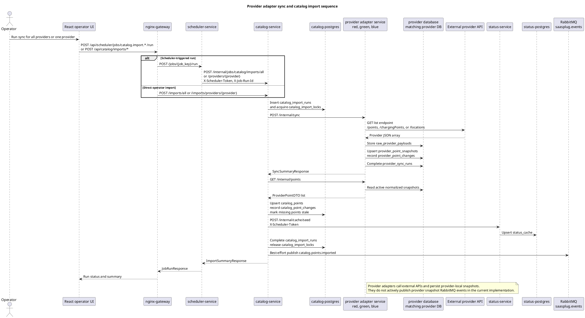

## 15. Sequence Diagram - Analytics And Billing Events

Source: `sequence-analytics-billing-events.puml`

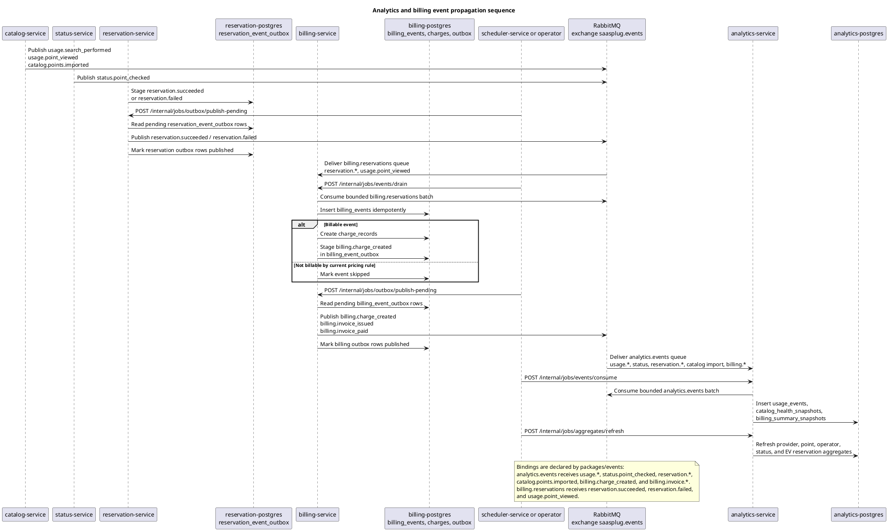
