# saasPlug UML Model

This is the PlantUML deliverable for the first part of the NTUA ECE course assignment "Τεχνολογίες Υπηρεσιών Λογισμικού".

The diagrams are embedded below as PlantUML blocks in the required deliverable order. The same sources are also kept as individual `.puml` files under `docs/diagrams/intermediate/puml/` for easier editing and validation.

GitHub source base used in component references:

`https://github.com/ntua-el21026/saasPlug`

## 1. Use Case Diagram

Source: `puml/01_use_case_diagram.puml`

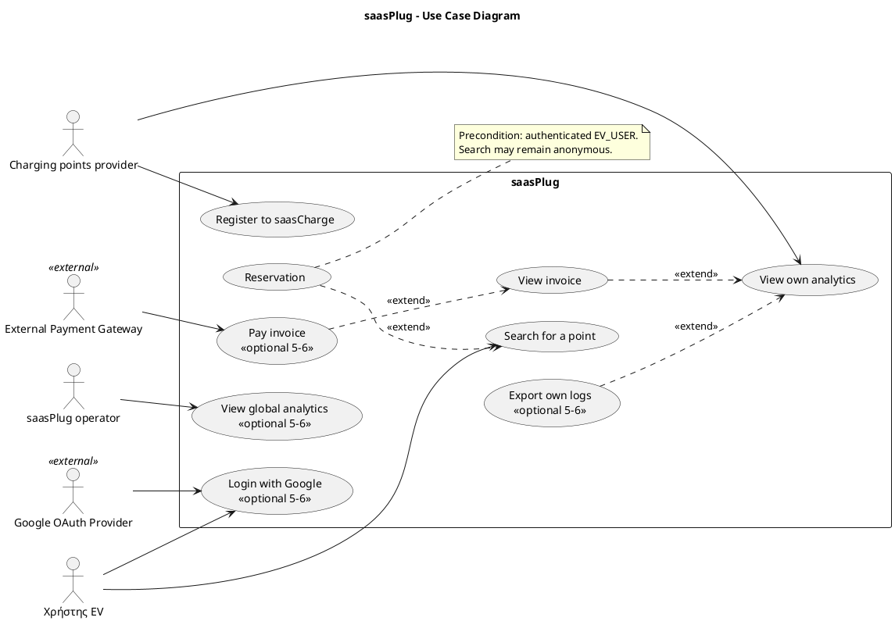

## 2. Activity Diagram - Provider Registration

Source: `puml/02_activity_provider_registration.puml`

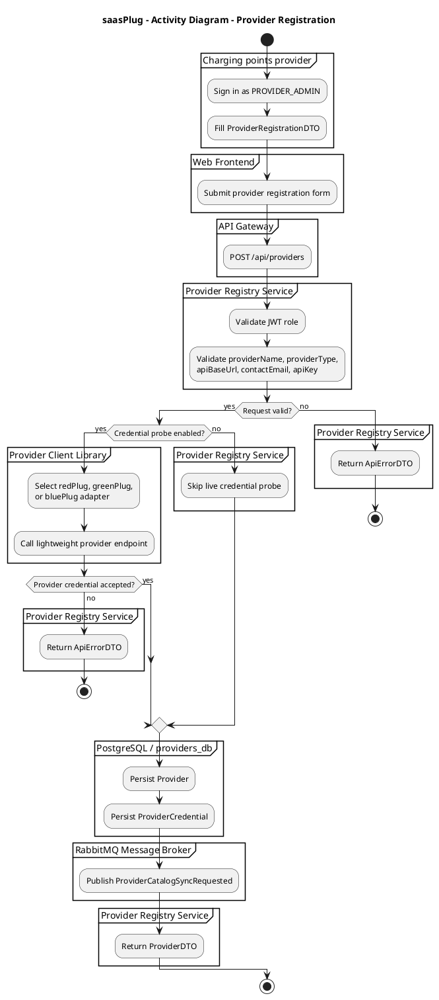

## 3. Activity Diagram - Provider Catalog Synchronization

Source: `puml/03_activity_provider_catalog_sync.puml`

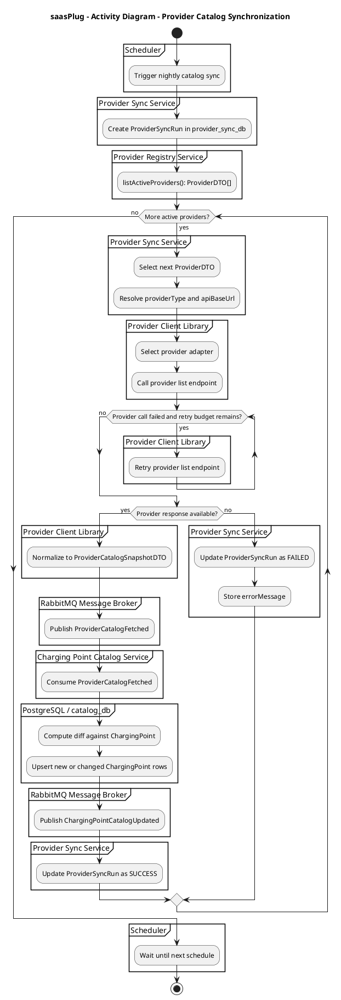

## 4. Activity Diagram - Search and Status Refresh

Source: `puml/04_activity_search_status_refresh.puml`

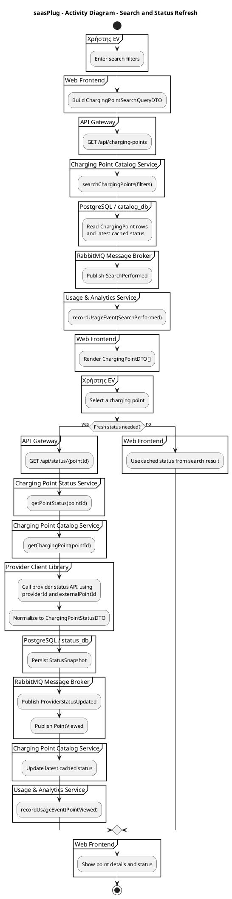

## 5. Activity Diagram - Reservation and Billing

Source: `puml/05_activity_reservation_billing.puml`

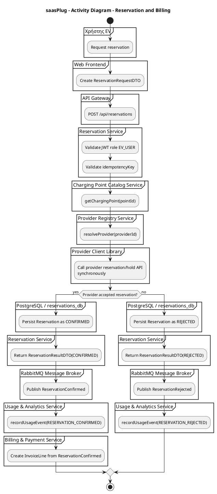

## 6. Class Diagram - Exchanged Data DTOs

Source: `puml/06_class_exchanged_data_dtos.puml`

```plantuml
@startuml
title saasPlug - Class Diagram - Exchanged Data DTOs
skinparam shadowing false
skinparam packageStyle rectangle
hide circle

package "Normalized saasPlug DTOs" {
  class AuthTokenDTO <<DTO>> {
    +accessToken: string
    +tokenType: string
    +expiresAt: datetime
    +user: UserDTO
  }

  class UserDTO <<DTO>> {
    +userId: UUID
    +email: string
    +displayName: string
    +role: string
  }

  class ProviderDTO <<DTO>> {
    +providerId: UUID
    +providerName: string
    +providerType: ProviderType
    +apiBaseUrl: string
    +contactEmail: string
    +status: string
    +registeredAt: datetime
  }

  class ProviderRegistrationDTO <<DTO>> {
    +providerName: string
    +apiBaseUrl: string
    +apiKey: string
    +providerType: ProviderType
    +contactEmail: string
  }

  class ChargingPointSearchQueryDTO <<DTO>> {
    +providerId: UUID?
    +connectorType: string?
    +status: ChargingPointStatus?
    +minCapacityKw: int?
    +maxPricePerKwh: decimal?
    +nearAddress: string?
    +limit: int
    +offset: int
  }

  class ChargingPointDTO <<DTO>> {
    +pointId: UUID
    +providerId: UUID
    +providerName: string
    +externalPointId: string
    +locationName: string?
    +address: string?
    +latitude: decimal?
    +longitude: decimal?
    +connectorType: string?
    +capacityKw: int
    +pricePerKwh: decimal?
    +status: ChargingPointStatus
    +reservationEndsAt: datetime?
    +lastStatusUpdatedAt: datetime?
  }

  class ChargingPointStatusDTO <<DTO>> {
    +pointId: UUID
    +providerId: UUID
    +externalPointId: string
    +status: ChargingPointStatus
    +reservationEndsAt: datetime?
    +pricePerKwh: decimal?
    +observedAt: datetime
  }

  class ProviderCatalogSnapshotDTO <<DTO>> {
    +providerId: UUID
    +providerName: string
    +fetchedAt: datetime
    +points: ChargingPointDTO[]
  }

  class ReservationRequestDTO <<DTO>> {
    +pointId: UUID
    +durationMinutes: int
    +idempotencyKey: string
  }

  class ReservationResultDTO <<DTO>> {
    +reservationId: UUID?
    +pointId: UUID
    +providerId: UUID
    +externalPointId: string
    +status: ReservationStatus
    +reservationEndsAt: datetime?
    +pricePerKwh: decimal?
    +message: string?
  }

  class UsageEventDTO <<DTO>> {
    +eventId: UUID
    +eventType: UsageEventType
    +actorId: UUID?
    +providerId: UUID?
    +pointId: UUID?
    +reservationId: UUID?
    +occurredAt: datetime
    +metadata: object
  }

  class DomainEventDTO <<DTO>> {
    +eventId: UUID
    +eventType: DomainEventType
    +correlationId: string?
    +occurredAt: datetime
    +payload: object
  }

  class AnalyticsQueryDTO <<DTO>> {
    +providerId: UUID?
    +periodStart: datetime
    +periodEnd: datetime
    +groupBy: string?
  }

  class AnalyticsSummaryDTO <<DTO>> {
    +providerId: UUID?
    +periodStart: datetime
    +periodEnd: datetime
    +searchCount: int
    +pointViewCount: int
    +reservationCount: int
    +confirmedReservationCount: int
    +revenueAmount: decimal
  }

  class ExportFileDTO <<DTO>> {
    +exportJobId: UUID
    +fileName: string
    +contentType: string
    +downloadUrl: string
    +expiresAt: datetime?
  }

  class InvoiceDTO <<DTO>> {
    +invoiceId: UUID
    +providerId: UUID
    +periodStart: date
    +periodEnd: date
    +status: InvoiceStatus
    +totalAmount: decimal
    +issuedAt: datetime
    +paidAt: datetime?
    +lines: InvoiceLineDTO[]
  }

  class InvoiceLineDTO <<DTO>> {
    +invoiceLineId: UUID
    +invoiceId: UUID
    +reservationId: UUID?
    +description: string
    +quantity: int
    +unitAmount: decimal
    +lineAmount: decimal
  }

  class PaymentDTO <<DTO>> {
    +paymentId: UUID
    +invoiceId: UUID
    +providerId: UUID
    +amount: decimal
    +status: PaymentStatus
    +externalPaymentId: string?
    +paidAt: datetime?
  }

  class ApiErrorDTO <<DTO>> {
    +code: string
    +message: string
    +details: object?
  }
}

package "Provider-Specific DTOs" {
  class RedPoint <<external DTO>> {
    +pointid: int
    +providerName: string
    +status: string
    +reservationendtime: string?
    +cap: int
    +connector: string?
    +locationName: string?
    +address: string?
  }

  class RedReserveResponse <<external DTO>> {
    +pointid: int
    +providerName: string
    +status: string
    +reservationendtime: string
  }

  class GreenPoint <<external DTO>> {
    +id: int
    +providerName: string
    +state: string
    +reservedUntil: string?
    +kwhRateEur: decimal
    +cap: int
    +connector: string?
    +locationName: string?
    +address: string?
  }

  class GreenReservationRequest <<external DTO>> {
    +duration: int
  }

  class GreenReserveResponse <<external DTO>> {
    +id: int
    +providerName: string
    +state: string
    +reservedUntil: string
    +kwhRateEur: decimal
  }

  class BluePoint <<external DTO>> {
    +chargerId: int
    +providerName: string
    +currentStatus: string
    +reservationEnd: string?
    +pricePerKwh: decimal
    +cap: int
    +connector: string?
    +locationName: string?
    +address: string?
  }

  class BlueReserveResponse <<external DTO>> {
    +chargerId: int
    +providerName: string
    +currentStatus: string
    +reservationEnd: string
    +pricePerKwh: decimal
  }
}

package "Enums" {
  enum ProviderType {
    RED_PLUG
    GREEN_PLUG
    BLUE_PLUG
    CUSTOM
  }

  enum ChargingPointStatus {
    AVAILABLE
    OCCUPIED
    RESERVED
    UNKNOWN
    OUT_OF_SERVICE
  }

  enum ReservationStatus {
    CONFIRMED
    REJECTED
    CANCELLED
    EXPIRED
  }

  enum UsageEventType {
    SEARCH_PERFORMED
    POINT_VIEWED
    RESERVATION_CONFIRMED
    RESERVATION_REJECTED
    INVOICE_ISSUED
    INVOICE_PAID
  }

  enum DomainEventType {
    PROVIDER_CATALOG_SYNC_REQUESTED
    PROVIDER_CATALOG_FETCHED
    CHARGING_POINT_CATALOG_UPDATED
    PROVIDER_STATUS_UPDATED
    POINT_VIEWED
    SEARCH_PERFORMED
    RESERVATION_CONFIRMED
    RESERVATION_REJECTED
    INVOICE_ISSUED
    INVOICE_PAID
  }

  enum InvoiceStatus {
    DRAFT
    ISSUED
    PAID
    OVERDUE
    CANCELLED
  }

  enum PaymentStatus {
    PENDING
    SUCCEEDED
    FAILED
  }
}

AuthTokenDTO --> UserDTO
ProviderDTO --> ProviderType
ProviderRegistrationDTO --> ProviderType
ChargingPointSearchQueryDTO --> ChargingPointStatus
ChargingPointDTO --> ChargingPointStatus
ChargingPointStatusDTO --> ChargingPointStatus
ProviderCatalogSnapshotDTO "1" o-- "*" ChargingPointDTO
ReservationResultDTO --> ReservationStatus
UsageEventDTO --> UsageEventType
DomainEventDTO --> DomainEventType
AnalyticsQueryDTO ..> AnalyticsSummaryDTO
InvoiceDTO --> InvoiceStatus
InvoiceDTO "1" o-- "*" InvoiceLineDTO
PaymentDTO --> PaymentStatus

RedPoint ..> ChargingPointDTO : normalized to
GreenPoint ..> ChargingPointDTO : normalized to
BluePoint ..> ChargingPointDTO : normalized to
RedReserveResponse ..> ReservationResultDTO : normalized to
GreenReserveResponse ..> ReservationResultDTO : normalized to
BlueReserveResponse ..> ReservationResultDTO : normalized to

@enduml
```

## 7. Class Diagram - Service APIs

Source: `puml/07_class_service_apis.puml`

```plantuml
@startuml
title saasPlug - Class Diagram - Service APIs
allowmixing
skinparam shadowing false
skinparam packageStyle rectangle
hide circle

package "Public and internal service APIs" {
  interface IdentityApi {
    +startGoogleOAuth(): RedirectResponse
    +completeGoogleOAuth(code: string): AuthTokenDTO
    +getCurrentUser(): UserDTO
  }

  interface ProviderRegistryApi {
    +registerProvider(request: ProviderRegistrationDTO): ProviderDTO
    +getOwnProvider(): ProviderDTO
    +listActiveProviders(): ProviderDTO[]
  }

  interface ChargingPointCatalogApi {
    +searchChargingPoints(filters: ChargingPointSearchQueryDTO): ChargingPointDTO[]
    +getChargingPoint(pointId: UUID): ChargingPointDTO
    +applyCatalogUpdate(snapshot: ProviderCatalogSnapshotDTO): void
  }

  interface ChargingPointStatusApi {
    +getPointStatus(pointId: UUID): ChargingPointStatusDTO
    +refreshPointStatus(pointId: UUID): ChargingPointStatusDTO
  }

  interface ReservationApi {
    +createReservation(request: ReservationRequestDTO): ReservationResultDTO
    +getReservation(reservationId: UUID): ReservationResultDTO
  }

  interface UsageAnalyticsApi {
    +getProviderAnalytics(query: AnalyticsQueryDTO): AnalyticsSummaryDTO
    +getGlobalAnalytics(query: AnalyticsQueryDTO): AnalyticsSummaryDTO
    +exportProviderUsageLog(query: AnalyticsQueryDTO): ExportFileDTO
    +recordUsageEvent(event: UsageEventDTO): void
  }

  interface BillingPaymentApi {
    +listProviderInvoices(): InvoiceDTO[]
    +getInvoice(invoiceId: UUID): InvoiceDTO
    +payInvoice(invoiceId: UUID, payment: PaymentDTO): PaymentDTO
    +createInvoiceLinesFromReservation(event: DomainEventDTO): void
  }
}

package "Implemented by components" {
  component "Identity & Access Service" as IdentityService
  component "Provider Registry Service" as ProviderRegistryService
  component "Charging Point Catalog Service" as CatalogService
  component "Charging Point Status Service" as StatusService
  component "Reservation Service" as ReservationService
  component "Usage & Analytics Service" as AnalyticsService
  component "Billing & Payment Service" as BillingService
}

IdentityService ..|> IdentityApi
ProviderRegistryService ..|> ProviderRegistryApi
CatalogService ..|> ChargingPointCatalogApi
StatusService ..|> ChargingPointStatusApi
ReservationService ..|> ReservationApi
AnalyticsService ..|> UsageAnalyticsApi
BillingService ..|> BillingPaymentApi

IdentityApi ..> AuthTokenDTO
IdentityApi ..> UserDTO
ProviderRegistryApi ..> ProviderRegistrationDTO
ProviderRegistryApi ..> ProviderDTO
ChargingPointCatalogApi ..> ChargingPointSearchQueryDTO
ChargingPointCatalogApi ..> ChargingPointDTO
ChargingPointCatalogApi ..> ProviderCatalogSnapshotDTO
ChargingPointStatusApi ..> ChargingPointStatusDTO
ReservationApi ..> ReservationRequestDTO
ReservationApi ..> ReservationResultDTO
UsageAnalyticsApi ..> AnalyticsQueryDTO
UsageAnalyticsApi ..> AnalyticsSummaryDTO
UsageAnalyticsApi ..> ExportFileDTO
UsageAnalyticsApi ..> UsageEventDTO
BillingPaymentApi ..> InvoiceDTO
BillingPaymentApi ..> PaymentDTO
BillingPaymentApi ..> DomainEventDTO

note right of IdentityApi
  GET /api/auth/google/start
  GET /api/auth/google/callback
  GET /api/users/me
end note

note right of ProviderRegistryApi
  POST /api/providers
  GET /api/providers/me
end note

note right of ChargingPointCatalogApi
  GET /api/charging-points
  GET /api/charging-points/{pointId}
end note

note right of ChargingPointStatusApi
  GET /api/status/{pointId}
end note

note right of ReservationApi
  POST /api/reservations
  GET /api/reservations/{reservationId}
end note

note right of UsageAnalyticsApi
  GET /api/analytics/provider/me
  GET /api/analytics/provider/me/export
  GET /api/analytics/operator/global
end note

note right of BillingPaymentApi
  GET /api/billing/provider/me/invoices
  GET /api/billing/provider/me/invoices/{invoiceId}
  POST /api/billing/provider/me/invoices/{invoiceId}/pay
end note

@enduml
```

## 8. Data Design Diagram - Persistence Model

Source: `puml/08_data_design_persistence_model.puml`

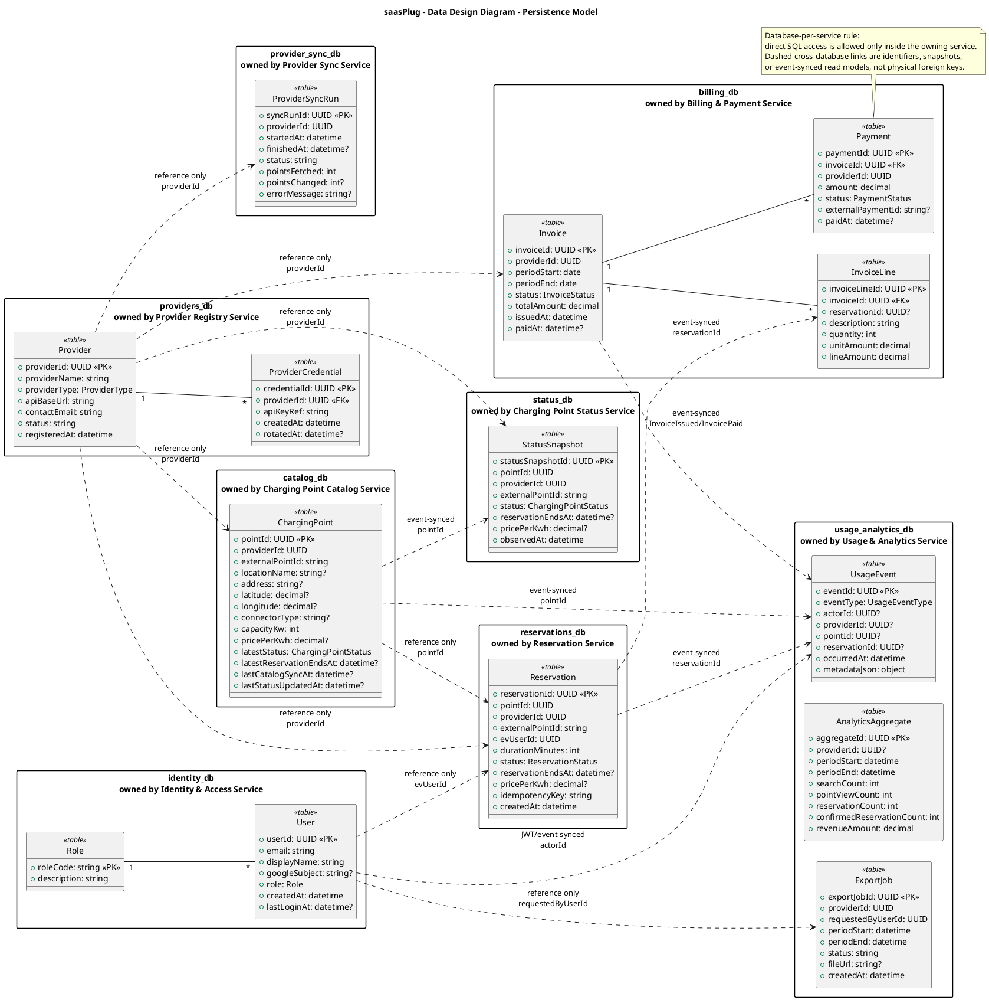

## 9. Component Diagram

Source: `puml/09_component_diagram.puml`

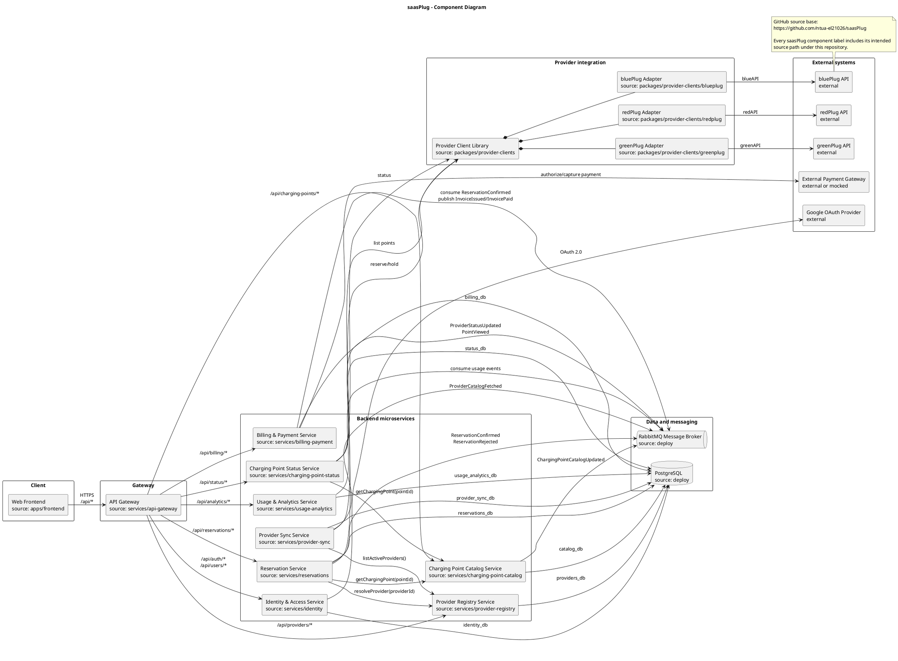

## 10. Deployment Diagram

Source: `puml/10_deployment_diagram.puml`

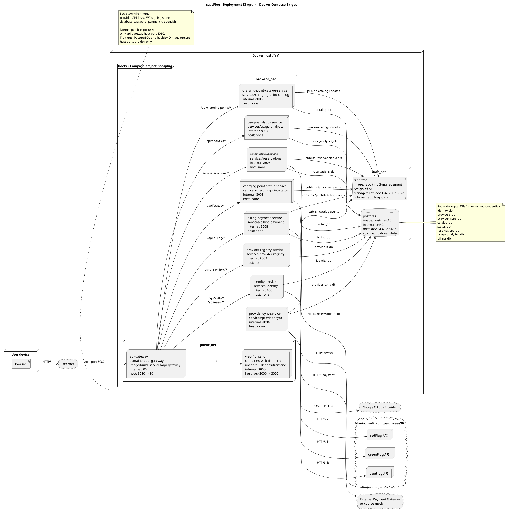

## 11. Sequence Diagram - Login with Google

Source: `puml/11_sequence_login_google.puml`

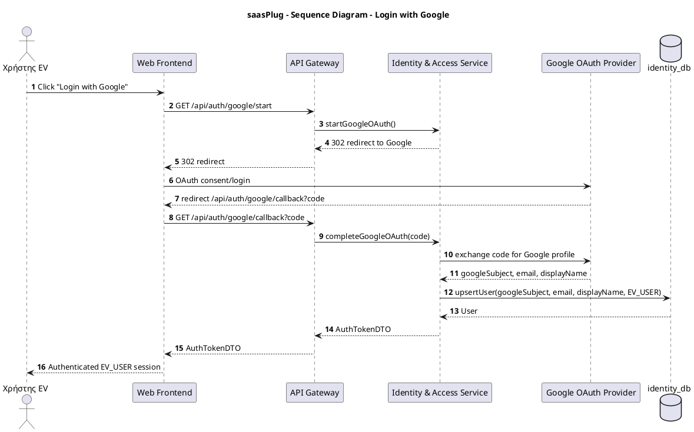

## 12. Sequence Diagram - Search for a Point

Source: `puml/12_sequence_search_point.puml`

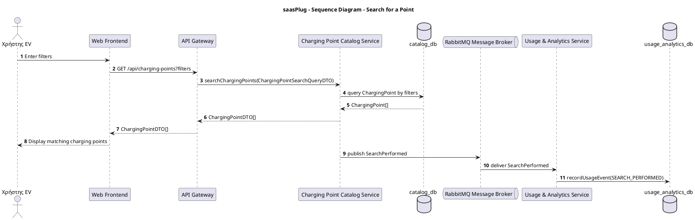

## 13. Sequence Diagram - View Fresh Point Status

Source: `puml/13_sequence_view_fresh_status.puml`

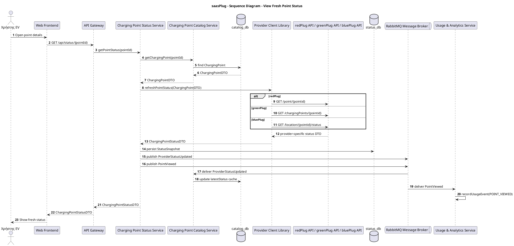

## 14. Sequence Diagram - Reservation

Source: `puml/14_sequence_reservation.puml`

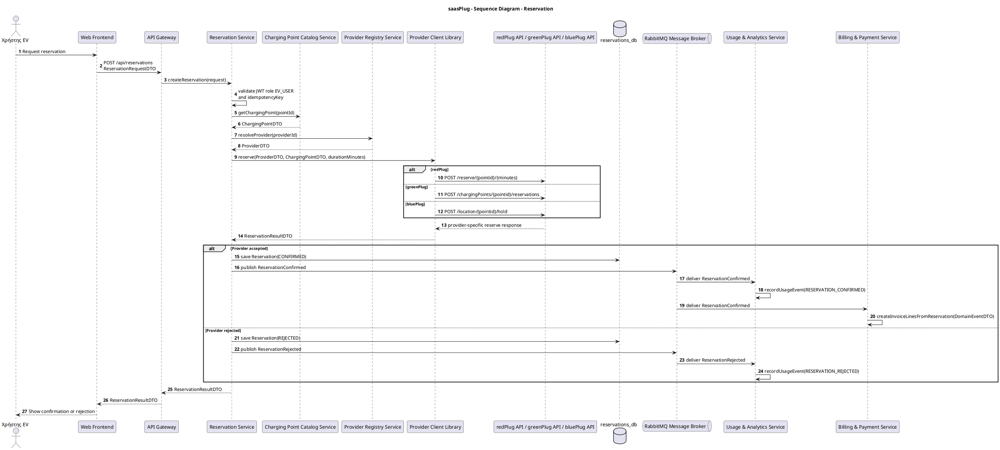

## 15. Sequence Diagram - Register to saasCharge

Source: `puml/15_sequence_register_saascharge.puml`

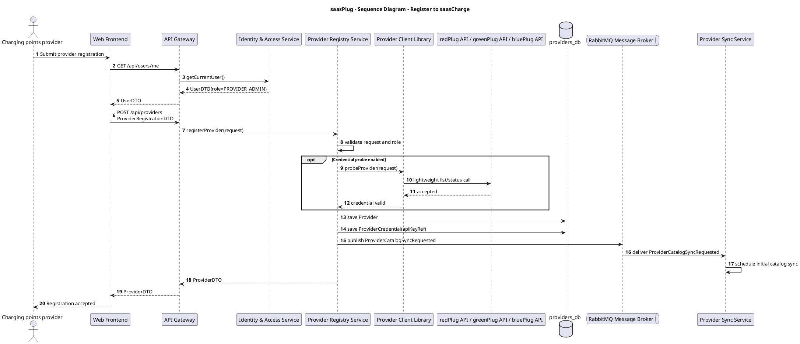

## 16. Sequence Diagram - Provider Catalog Sync

Source: `puml/16_sequence_provider_catalog_sync.puml`

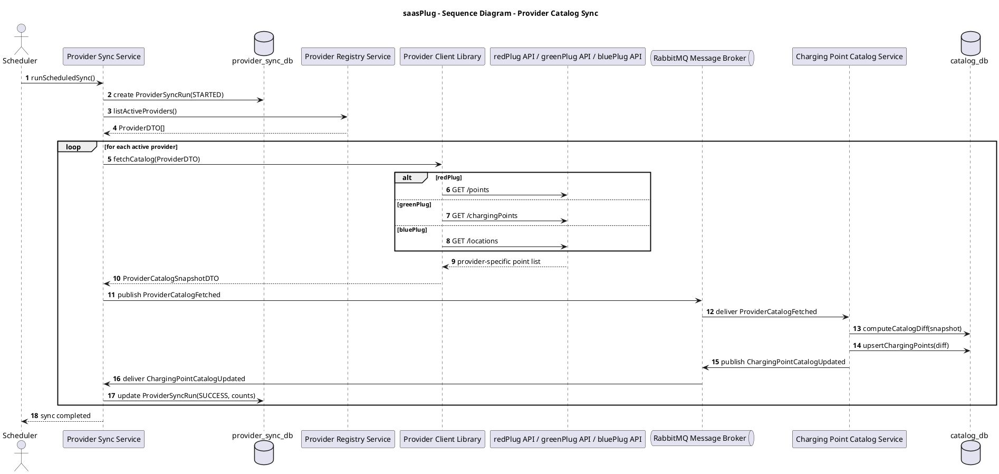

## 17. Sequence Diagram - View Analytics and Export Logs

Source: `puml/17_sequence_analytics_export.puml`

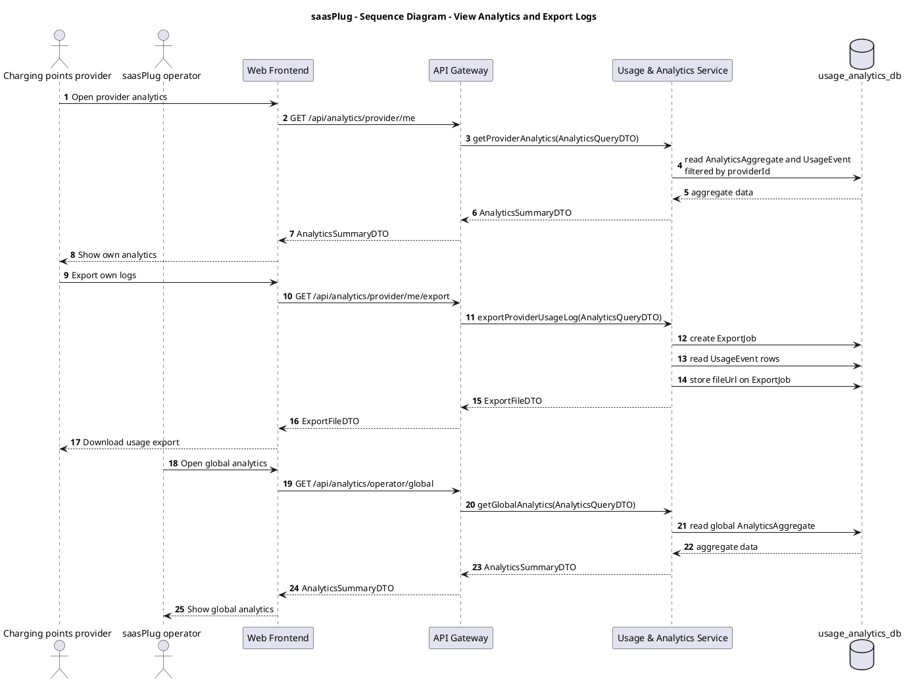

## 18. Sequence Diagram - View Invoice and Pay Invoice

Source: `puml/18_sequence_invoice_payment.puml`

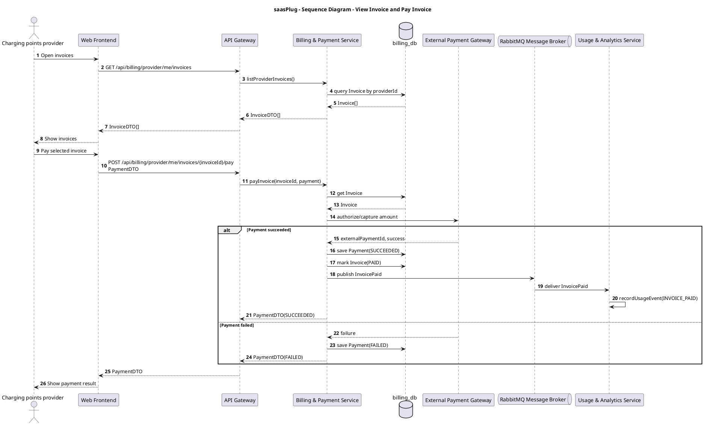
